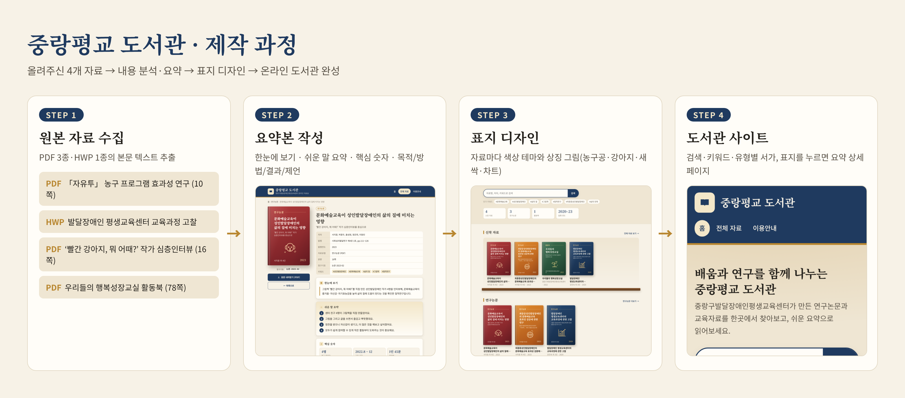

# 중랑평교 도서관

중랑구발달장애인평생교육센터의 연구논문·활동북·교육자료를 표지로 둘러보고, 누르면 요약본(한눈에 보기 · 쉬운 말 요약 · 핵심 숫자 · 상세 요약)을 볼 수 있는 온라인 도서관입니다.

- 실행: `index.html`을 브라우저로 열기 (또는 GitHub Pages로 배포)
- 자료 추가 방법: [CLAUDE.md](CLAUDE.md)

